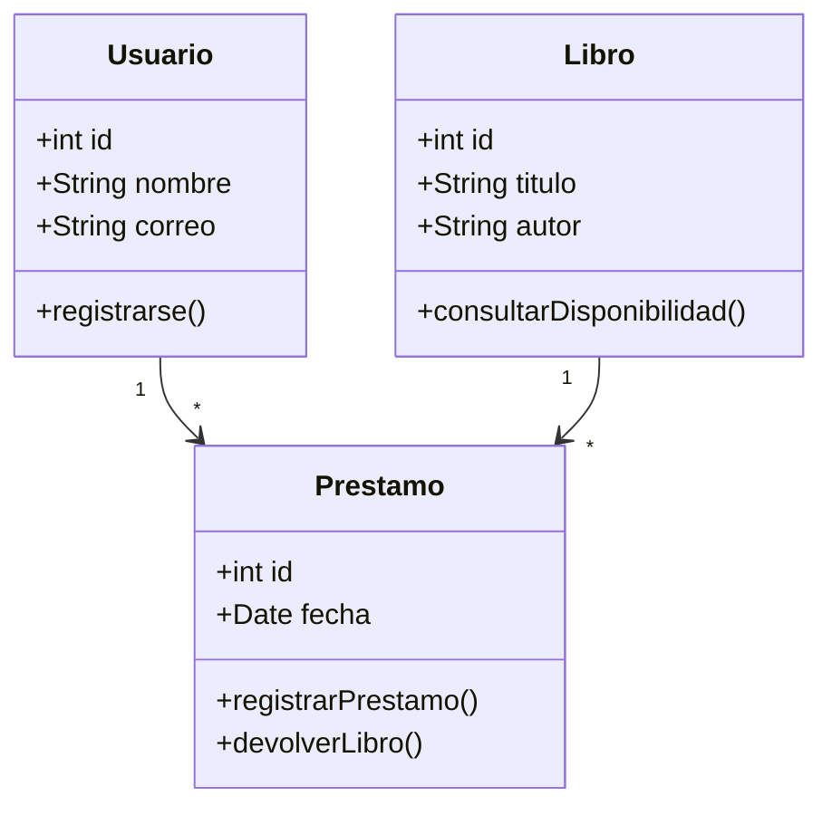

# Investigación sobre StarUML: herramienta para el modelado y diseño de software

## 1. Introducción

En la actualidad, el desarrollo de software requiere herramientas que permitan analizar, diseñar y organizar los sistemas informáticos antes de comenzar su programación. Una de las actividades más importantes en este proceso es el modelado de software, ya que permite representar gráficamente cómo estará construido un sistema, cuáles serán sus funcionalidades y cómo se relacionarán sus diferentes componentes.

En este contexto surge StarUML, una aplicación especializada en el modelado de sistemas mediante diferentes lenguajes y estándares de representación, principalmente UML (Unified Modeling Language). Esta herramienta permite elaborar diagramas que facilitan la comprensión de los proyectos informáticos, ayudan a organizar las ideas y permiten documentar de manera estructurada el funcionamiento de una aplicación.

StarUML es utilizado en el ámbito académico y profesional porque ofrece funcionalidades para diseñar sistemas orientados a objetos, representar arquitecturas de software, modelar bases de datos y documentar procesos. Su utilización contribuye a mejorar la planificación de los proyectos y a reducir errores durante las etapas iniciales del desarrollo.

## 2. ¿Qué es StarUML?

StarUML es una herramienta CASE (Computer-Aided Software Engineering), cuya traducción es Ingeniería de Software Asistida por Computadora. Este tipo de herramientas tiene como finalidad facilitar las actividades relacionadas con el análisis, diseño, modelado y documentación de sistemas informáticos.

La aplicación está diseñada para trabajar principalmente con UML, un lenguaje de modelado estandarizado que permite representar visualmente los diferentes elementos que conforman un sistema. Mediante sus herramientas gráficas, los usuarios pueden crear clases, objetos, actores, componentes, actividades y relaciones entre los elementos.

Una de las características más importantes de StarUML es que no se limita únicamente a la elaboración de dibujos. También permite construir modelos estructurados que contienen información sobre los elementos del sistema, sus propiedades y sus relaciones. Esto significa que los diagramas forman parte de un modelo organizado que puede utilizarse durante diferentes etapas del desarrollo de software.

Además, StarUML permite trabajar con otros tipos de modelado, como diagramas entidad-relación, diagramas de flujo, diagramas de arquitectura C4, SysML y BPMN, dependiendo de la edición y las funcionalidades disponibles.

## 3. Historia y evolución de StarUML

StarUML surgió como una herramienta destinada a facilitar el modelado de sistemas mediante UML. Con el paso del tiempo, ha evolucionado para incorporar nuevas tecnologías, mejorar su interfaz y ampliar sus capacidades de diseño.

En sus primeras versiones, la aplicación se enfocaba principalmente en la creación de diagramas UML y en la representación de sistemas orientados a objetos. Posteriormente, incorporó mecanismos de extensibilidad que permitieron agregar nuevas funcionalidades mediante complementos desarrollados por terceros.

Con las versiones posteriores, StarUML amplió su compatibilidad con diferentes lenguajes de programación y herramientas de ingeniería de software. También incorporó capacidades de generación de código, ingeniería inversa, validación de modelos y documentación de proyectos.

Una evolución importante fue la incorporación de Mermaid, que permite generar diagramas mediante instrucciones escritas en texto. Esta funcionalidad facilita la elaboración rápida de modelos sin necesidad de construir manualmente todos sus elementos.

En noviembre de 2026, StarUML cuenta con la versión 8.0.2, cuya plataforma fue reconstruida utilizando Rust para mejorar el rendimiento y la estabilidad. También mantiene funcionalidades para trabajar con diferentes lenguajes de modelado y generación de código.

Fuente: [Historial oficial de versiones de StarUML](<https://staruml.io/changelog/?utm_source=chatgpt.com>).

## 4. Funcionamiento y entorno de trabajo de StarUML

El funcionamiento de StarUML se basa en la creación de proyectos que contienen modelos y diagramas. Cada proyecto puede organizarse en diferentes paquetes, los cuales permiten agrupar los elementos relacionados con una determinada parte del sistema.

Cuando el usuario inicia un proyecto, encuentra un entorno de trabajo compuesto por diferentes áreas que facilitan la elaboración de los modelos.

Entre sus principales componentes se encuentran:

Explorador del modelo: permite visualizar y organizar los elementos que forman parte del proyecto. Desde esta sección se pueden administrar paquetes, clases, interfaces y otros componentes.

Área de diagramación: es el espacio principal donde se construyen los diagramas. En esta área se agregan y organizan los elementos gráficos, estableciendo las relaciones necesarias.

Barra de herramientas: contiene las opciones que permiten insertar elementos, modificar propiedades, establecer conexiones y realizar diferentes operaciones.

Panel de propiedades: permite modificar las características de los elementos seleccionados, como su nombre, atributos, métodos y otras propiedades.

Sistema de navegación: facilita localizar los modelos y diagramas dentro de proyectos que contienen numerosos elementos.

La combinación de estas herramientas permite construir modelos organizados y mantener una estructura lógica durante todo el proceso de diseño.

## 5. Lenguaje UML y su relación con StarUML

UML significa Unified Modeling Language o Lenguaje Unificado de Modelado. Es un estándar utilizado en la ingeniería de software para visualizar, especificar y documentar los componentes y comportamientos de un sistema.

Su principal objetivo es proporcionar una forma común de representar los sistemas informáticos, permitiendo que analistas, diseñadores y programadores puedan comprender cómo está organizado un proyecto.

StarUML utiliza UML como uno de sus principales lenguajes de modelado. Gracias a esta integración, permite representar tanto la estructura interna de una aplicación como las interacciones que ocurren durante su funcionamiento.

UML se divide principalmente en dos grandes categorías:

Diagramas estructurales: representan la organización estática de un sistema. Permiten identificar las clases, objetos, componentes, paquetes y relaciones que forman parte de una aplicación.

Diagramas de comportamiento: representan las acciones, procesos e interacciones que ocurren dentro del sistema. Permiten comprender cómo funcionan sus diferentes operaciones y cómo responden los elementos ante determinados eventos.

Esta clasificación permite analizar un sistema desde diferentes perspectivas y facilita su diseño antes de comenzar la programación.

## 6. Principales tipos de diagramas que permite desarrollar

StarUML ofrece herramientas para elaborar diferentes tipos de diagramas que se utilizan durante el desarrollo de software.

### 6.1. Diagrama de clases

El diagrama de clases es uno de los más utilizados en la programación orientada a objetos. Su finalidad es representar las clases que conforman un sistema, junto con sus atributos, métodos y relaciones.

Una clase representa una estructura que define las características y comportamientos que tendrán determinados objetos.

Por ejemplo, en un sistema académico pueden existir las clases Estudiante, Profesor, Asignatura y Matrícula. Cada una contiene información y operaciones específicas que permiten representar el funcionamiento del sistema.

Este diagrama resulta fundamental para diseñar la estructura de una aplicación y establecer cómo se relacionarán sus componentes.

### 6.2. Diagrama de casos de uso

El diagrama de casos de uso permite representar las funcionalidades que ofrece un sistema desde la perspectiva de sus usuarios.

En este tipo de diagrama aparecen los actores, que representan a las personas u otros sistemas que interactúan con la aplicación, y los casos de uso, que describen las acciones que pueden realizar.

Por ejemplo, en un sistema bancario pueden existir funcionalidades como consultar saldo, realizar transferencias, retirar dinero y actualizar información personal.

Su importancia radica en que permite identificar los requisitos funcionales de una aplicación y comprender qué servicios debe proporcionar el sistema.

### 6.3. Diagrama de secuencia

El diagrama de secuencia representa las interacciones entre diferentes objetos durante la ejecución de un proceso.

Su característica principal es que organiza los mensajes de acuerdo con el orden en que ocurren en el tiempo.

Por ejemplo, cuando un usuario inicia sesión en una aplicación, el sistema recibe sus credenciales, verifica la información en la base de datos y posteriormente devuelve una respuesta indicando si el acceso fue autorizado.

Este diagrama permite comprender la comunicación entre los componentes y analizar el comportamiento de una funcionalidad específica.

### 6.4. Diagrama de actividades

El diagrama de actividades representa los procesos y flujos de trabajo de un sistema.

Permite mostrar las acciones que se ejecutan, las decisiones que pueden presentarse y las diferentes rutas que puede seguir un procedimiento.

Un ejemplo sería el proceso de compra en una tienda virtual, donde el usuario selecciona un producto, lo agrega al carrito, realiza el pago y recibe una confirmación de compra.

Este tipo de diagrama facilita la comprensión de los procedimientos y permite identificar posibles problemas en el flujo de trabajo.

### 6.5. Diagrama de componentes

El diagrama de componentes representa la organización interna de una aplicación mediante módulos o componentes de software.

Permite identificar las partes principales del sistema y establecer cómo se comunican entre sí.

Por ejemplo, una plataforma de comercio electrónico puede estar formada por un componente de usuarios, uno de productos, uno de pagos y otro encargado de administrar los pedidos.

Su utilización es importante durante el diseño de arquitecturas de software porque facilita la organización de sistemas grandes y complejos.

### 6.6. Diagrama de despliegue

El diagrama de despliegue representa la distribución física de los componentes de software en los diferentes dispositivos o servidores donde se ejecutan.

Permite identificar servidores, equipos, dispositivos, conexiones y entornos de ejecución.

Por ejemplo, una aplicación web puede ejecutarse en un servidor principal, conectarse a un servidor de bases de datos y permitir el acceso de los usuarios mediante sus dispositivos.

Este diagrama resulta útil para comprender la infraestructura tecnológica necesaria para implementar un sistema.

## 7. Otras herramientas y lenguajes de modelado disponibles

Una de las ventajas de StarUML es que sus capacidades no se limitan al lenguaje UML. También incorpora otras alternativas para representar diferentes aspectos de los sistemas informáticos.

Entre ellas se encuentran:

- ERD (Entity Relationship Diagram): permite representar entidades, atributos y relaciones de una base de datos.
- DFD (Data Flow Diagram): representa el movimiento y procesamiento de la información dentro de un sistema.
- Flowchart: permite describir procesos mediante símbolos y conexiones.
- Mindmap: facilita organizar ideas y conceptos mediante estructuras jerárquicas.
- C4 Model: permite representar la arquitectura de software desde diferentes niveles de abstracción.
- SysML: se utiliza para modelar sistemas complejos que pueden integrar componentes de hardware y software.
- BPMN: permite representar procesos de negocio y sus diferentes actividades.

La disponibilidad de algunos de estos lenguajes depende de la edición de StarUML utilizada.

Fuente: [Características y lenguajes de modelado oficiales](<https://docs.staruml.io/user-guide/readme/?utm_source=chatgpt.com>).

## 8. Aplicaciones de StarUML en el desarrollo de software

StarUML tiene diferentes aplicaciones dentro del ciclo de vida del desarrollo de software. Su utilización permite trabajar en varias etapas de un proyecto, desde la identificación de necesidades hasta la documentación del producto final.

Durante el análisis de requisitos, permite representar las funcionalidades que necesita el usuario y establecer las interacciones que tendrá con el sistema.

En la etapa de diseño, facilita la construcción de modelos que describen la estructura de la aplicación, sus clases, componentes y relaciones.

Durante la implementación, los modelos pueden servir como referencia para los programadores. Además, determinadas funcionalidades permiten generar código fuente a partir de los modelos y obtener modelos a partir del código existente.

En la etapa de documentación, StarUML permite generar documentación técnica y exportar diagramas para compartir información con otros integrantes del equipo.

Por lo tanto, esta herramienta contribuye a mantener una relación entre el análisis, el diseño, la programación y la documentación de un proyecto informático.

## 9. Generación de código e ingeniería inversa

Una de las funcionalidades relevantes de StarUML es su capacidad de trabajar con la generación de código y la ingeniería inversa.

La generación de código consiste en transformar determinados modelos diseñados dentro de la aplicación en estructuras de código fuente correspondientes a lenguajes de programación compatibles.

Por ejemplo, un modelo de clases puede utilizarse para generar estructuras iniciales de clases en Java, C++, C#, Python o JavaScript.

Esta funcionalidad permite reducir parte del trabajo manual de programación y mantener una relación entre el diseño y la implementación.

Por otra parte, la ingeniería inversa realiza el proceso contrario: analiza código fuente existente para construir modelos que permitan comprender su estructura.

Esto resulta especialmente útil cuando se trabaja con proyectos que ya están desarrollados y se necesita conocer su organización interna.

Sin embargo, es importante aclarar que la generación automática de código no crea por sí sola una aplicación completa. El código generado generalmente necesita ser revisado, complementado y adaptado por los desarrolladores.

Fuente: [Funciones de generación de código de StarUML](<https://staruml.io/?utm_source=chatgpt.com>).

## 10. Integración de StarUML con Markdown y Mermaid

Una característica especialmente interesante de StarUML es su integración con Markdown y Mermaid.

Markdown es un lenguaje de marcado ligero que permite escribir documentos utilizando una sintaxis sencilla. Se utiliza principalmente para crear documentación técnica, archivos de instrucciones, descripciones de proyectos y contenidos organizados.

StarUML permite utilizar sintaxis Markdown para documentar los elementos de un modelo. Esto significa que es posible agregar explicaciones, descripciones y documentación a las clases, componentes y otros elementos del proyecto.

Por otro lado, Mermaid permite crear diagramas mediante instrucciones escritas en texto. En lugar de construir manualmente cada elemento gráfico, el usuario escribe una estructura de código que posteriormente puede transformarse en un diagrama.

Por ejemplo, para representar las clases de un sistema de biblioteca se puede utilizar:

mermaid

Este código representa las relaciones entre las clases Usuario, Libro y Prestamo.

Para generar un diagrama utilizando Mermaid dentro de StarUML, se debe acceder a la opción Tools \> Generate Diagram by Mermaid, introducir el código y generar el modelo.

Esta integración permite trabajar de una manera más rápida y facilita la documentación de los sistemas mediante texto y diagramas.

Es importante señalar que la compatibilidad con Mermaid tiene algunas limitaciones respecto a las características de los diagramas UML tradicionales.

Fuente: [Documentación oficial de Mermaid en StarUML](<https://docs.staruml.io/user-guide/mermaid-support/?utm_source=chatgpt.com>).

## 11. Ventajas de utilizar StarUML

StarUML presenta diferentes ventajas dentro del desarrollo de software. Una de las más importantes es que permite representar sistemas complejos mediante modelos gráficos, facilitando su comprensión y análisis.

También contribuye a mejorar la organización de los proyectos, ya que permite mantener los diferentes diagramas dentro de una misma estructura.

Otra ventaja es su compatibilidad con varios lenguajes de modelado y programación, lo que amplía sus posibilidades de aplicación en diferentes proyectos.

Su capacidad de extensibilidad permite agregar nuevas funcionalidades y adaptar la herramienta a las necesidades de los usuarios.

Asimismo, ofrece funciones para validar modelos, generar documentación y exportar diagramas en diferentes formatos. Estas características facilitan el trabajo de los desarrolladores y mejoran la presentación de los proyectos.

## 12. Desventajas y limitaciones de StarUML

A pesar de sus beneficios, StarUML también presenta algunas limitaciones que deben considerarse.

En primer lugar, es un software comercial, por lo que determinadas funcionalidades requieren una licencia. Esto puede representar una dificultad para estudiantes o usuarios que buscan herramientas completamente gratuitas.

También requiere conocimientos básicos de UML para elaborar modelos correctamente. Una persona que no conoce los conceptos de clases, relaciones, herencia, asociaciones y otros elementos puede encontrar dificultades al comenzar a utilizarlo.

Otra limitación está relacionada con las extensiones, debido a que algunos complementos desarrollados para versiones anteriores pueden no funcionar en las versiones más recientes.

Finalmente, aunque permite generar código a partir de modelos, no reemplaza el trabajo de programación ni garantiza que el sistema generado cumpla con todos los requisitos del proyecto.

## 13. Comparación de StarUML con otras herramientas de modelado

Existen diferentes aplicaciones que cumplen funciones similares a StarUML. Entre las más conocidas se encuentran Visual Paradigm, Lucidchart y PlantUML.

| Herramienta | Característica principal |
| --- | --- |
| StarUML | Modelado UML, arquitectura y generación de código. |
| Visual Paradigm | Modelado empresarial, UML y procesos de negocio. |
| Lucidchart | Creación colaborativa de diagramas en línea. |
| PlantUML | Generación de diagramas mediante código textual. |

